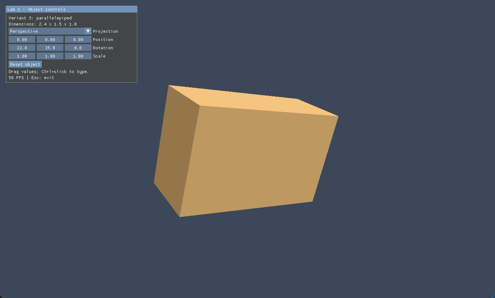
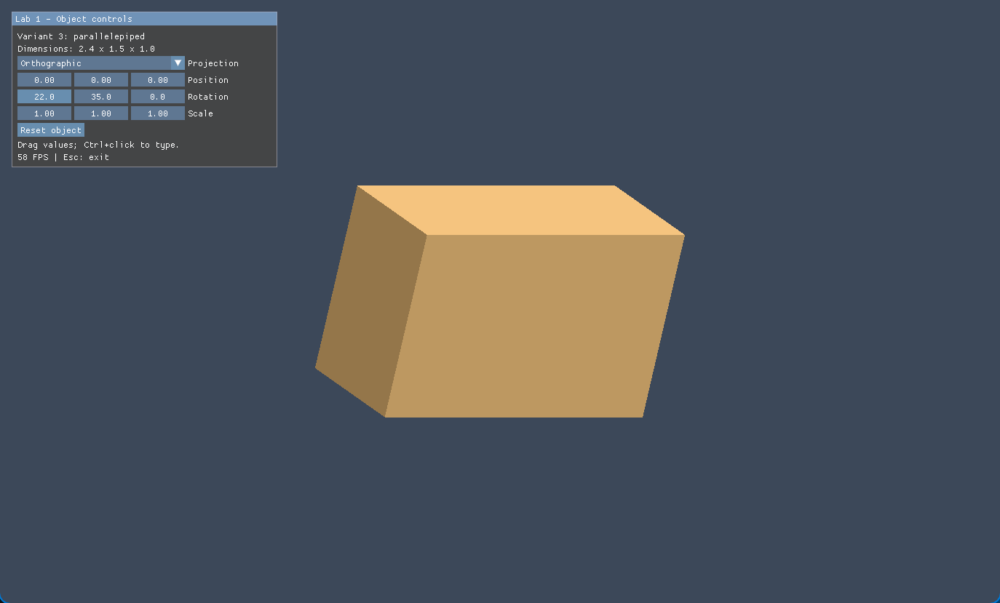

# Лабораторная работа №1

МОСКОВСКИЙ АВИАЦИОННЫЙ ИНСТИТУТ
(НАЦИОНАЛЬНЫЙ ИССЛЕДОВАТЕЛЬСКИЙ УНИВЕРСИТЕТ)

Институт №8 «Компьютерные науки и прикладная математика»
Кафедра 806 «Вычислительная математика и программирование»

Курс «Компьютерная графика»
Основы 3D графики
Вариант 3 — Параллелепипед

Выполнил: ______________________________
Группа: М8О-____________________________
Преподаватель: В. Д. Бахарев

Москва, 2026

## Условие

Цель работы — построить простой трёхмерный объект, спроецировать его на
двумерный экран и реализовать отрисовку с помощью Vulkan, GLFW и ImGui.

При порядковом номере 27 и 12 вариантах номер задания равен
`((27 - 1) % 12) + 1 = 3`. Вариант 3 — параллелепипед.
Выполнен вариант базового задания с динамической сменой проекции
и преобразованиями объекта через ImGui согласно общим требованиям.

## Метод решения

Программа написана на C++20 на основе стартового проекта лектора.
GLFW создаёт окно и обрабатывает события. Vulkan рисует фигуру,
ImGui выводит информационную панель с вариантом, параметрами сцены,
элементами управления и FPS.

Построен прямоугольный параллелепипед с длинами рёбер 2.4, 1.5 и 1.0.
Координаты восьми углов задаются комбинациями x = ±1.2,
y = ±0.75 и z = ±0.5. Каждая из шести граней разбита на два треугольника.
В буфере вершин хранятся 24 записи: четыре вершины каждой грани имеют
общую нормаль, поэтому рёбра остаются резкими. Индексный буфер содержит
36 индексов, образующих 12 треугольников.

Для вывода применяется преобразование `p_clip = P * V * M * p_local`.
Матрица модели `M = T * Rz * Ry * Rx * S` задаёт перенос, поворот
вокруг трёх осей и масштабирование. Параметры изменяются во время работы.
Матрица вида `V = T(0, 0, -5.5)` размещает фигуру перед камерой.
Выпадающий список Projection переключает перспективную и ортографическую матрицы проекции.
Перспектива использует вертикальный угол обзора 45°, ортографическая
проекция — вертикальный охват 4.6 единицы. Для обеих проекций ближняя
плоскость равна 0.1, дальняя — 100.0; соотношение сторон берётся из размера
изображения окна. Учитываются диапазон глубины Vulkan [0, 1] и ось Y.

В initialize создаются вершинный и индексный VkBuffer через VMA,
VkPipelineLayout и графический VkPipeline. Шейдеры GLSL компилируются
glslc в SPIR-V при сборке CMake. Временные VkShaderModule уничтожаются
после создания конвейера. Матрицы MVP и преобразования нормалей передаются
через push constants общим размером 128 байт. Нормали преобразуются
матрицей R * inverse(S), поэтому освещение учитывает поворот и масштаб.
Наборы дескрипторов для фигуры не нужны.

В render записываются команды в полученный VkCommandBuffer: очищаются
цвет и глубина, начинается render pass, задаются viewport и scissor,
подключаются конвейер и буферы, вызывается vkCmdDrawIndexed для 36 индексов.
Проверка глубины с операцией LESS скрывает поверхности, расположенные
за видимыми гранями. Фрагментный шейдер использует постоянный цвет
и фиксированное диффузное освещение в мировых координатах.

В update формируется панель ImGui с выпадающим списком проекции и полями
Position, Rotation, Scale. Значения изменяются мышью или вводом числа через
Ctrl+щелчок. Reset object сбрасывает настройки. Масштаб по каждой оси ограничен
пределами 0.1–3.0, чтобы исключить вырожденную матрицу.
При изменении размера окна пересчитывается выбранная проекция.
При сворачивании отрисовка приостанавливается.
В shutdown после ожидания очереди уничтожаются конвейер, его layout
и оба буфера. Остальные объекты Vulkan освобождает стартовый код.

## Результаты

Рисунок 1. Положение, поворот и масштаб доступны в панели ImGui; выбрана перспектива.

Рисунок 2. Ортографическая проекция выбрана мышью через список Projection.

Проверены сборка, запуск, выбор проекции через ImGui, сворачивание и закрытие.
В проверенном запуске ошибок и предупреждений валидации Vulkan не было.

## Выводы

Реализовано базовое задание варианта 3: отрисовка параллелепипеда
в реальном времени с переключением проекции и преобразованиями объекта
через ImGui. В решении используются
индексированная геометрия, матрицы преобразования, графический конвейер,
шейдеры и буфер глубины. Ресурсы фигуры освобождаются при завершении.

## Использованные материалы

- CG Lab #1.pdf — условие и варианты.
- CG Lecture #1 Introduction.pptx — введение в Vulkan и 3D-графику.
- CG Lecture #2 Graphics pipeline.pptx — графический конвейер и шейдеры.
- CG Lecture #3 Descriptors and buffers.pptx — буферы и передача данных.
- 3XX_Фамилия_ЛабX.docx — структура отчёта.
- Стартовый проект: https://github.com/vladeemerr/vulkan-starter-app
