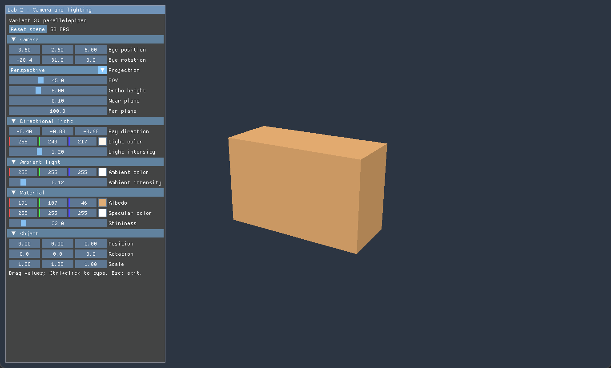
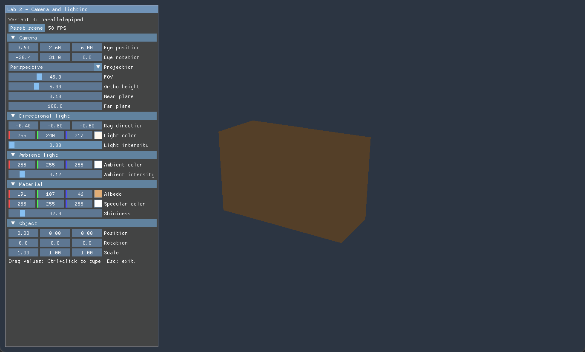

# Лабораторная работа 2

## Условие

Камера и освещение. Вариант 3: параллелепипед, унаследованный из первой лабораторной.
Базовое задание: один направленный источник, ambient light и модель Блинн–Фонга.
Параметры камеры, света и материала изменяются через ImGui. Дополнительные задания не выполнялись.

## Метод решения

Программа написана на C++20 с Vulkan, GLFW и ImGui. Геометрия состоит из 24 записей
вершин и 36 индексов. Нормаль каждой грани вычисляется процедурно как нормализованное
векторное произведение двух её рёбер; четыре вершины грани получают одинаковую нормаль.

Матрица модели M = T * Rz * Ry * Rx * S. Камера задаётся позицией и тремя углами;
матрица вида V = transpose(Rcamera) * T(-cameraPosition). Проекция учитывает
текущее соотношение сторон окна и диапазон глубины Vulkan [0,1]. В интерфейсе
доступны позиция, поворот, FOV и плоскости отсечения камеры, а также преобразования объекта.

Во фрагментном шейдере вычисляются нормаль N, направление к свету L, направление
к камере V и полувектор H = normalize(L+V). Рассеянная составляющая пропорциональна
max(dot(N,L),0), блик — pow(max(dot(N,H),0),shininess) на освещённой стороне.
Итоговый цвет складывается из ambient * albedo и направленного света, умноженного
на сумму диффузного цвета и цвета блика. Цвет и интенсивность света, ambient,
альбедо, цвет блика и shininess доступны в ImGui.

Один uniform-буфер содержит матрицы и параметры сцены. Он подключён одним набором
дескрипторов к обоим шейдерам и обновляется после ожидания fence предыдущего кадра.
Это исключает одновременную запись CPU и чтение GPU. Проверка глубины скрывает
дальние поверхности. Ресурсы освобождаются после ожидания графической очереди.

## Результаты

Рисунок 1. Параллелепипед с направленным и фоновым светом; слева панель параметров.

Рисунок 2. Интенсивность направленного света изменена в ImGui на 0; остаётся ambient.

## Выводы

Реализовано базовое задание: камера и освещение Блинн–Фонга для одного направленного
источника. Проверены сборка, запуск, изменение интенсивности света и FOV через ImGui,
сворачивание, восстановление и закрытие. В проверенных запусках ошибок и предупреждений
Vulkan Validation Layers не было. Условие: Lab #2 Camera and Lighting.pdf.
