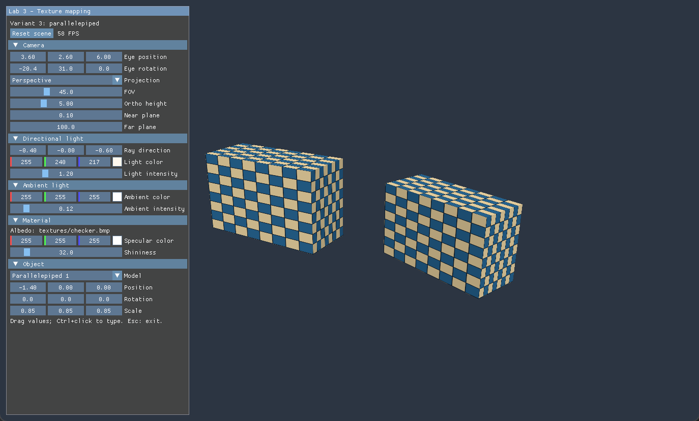
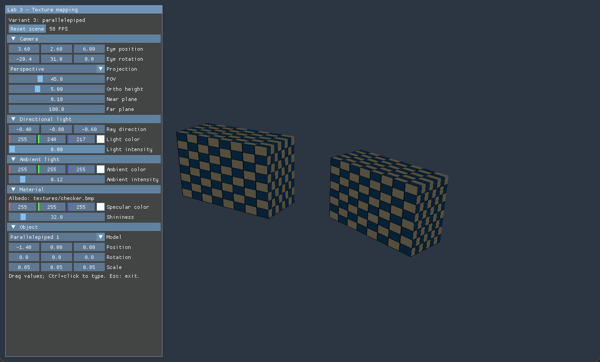

# Лабораторная работа 3

## Условие

Текстурирование. Вариант 3: параллелепипед. Базовое задание: одна текстура альбедо
из файла, данные геометрии в памяти GPU, один динамический uniform-буфер и общий
набор дескрипторов. Дополнительные эффекты и текстуры не реализованы.

## Метод решения

Решение продолжает Lab2 на C++20, Vulkan, GLFW и ImGui. Для каждой грани генерируются
нормаль и UV-координаты четырёх углов прямоугольника: (0,1), (1,1), (1,0), (0,0).
Изображение textures/checker.bmp декодируется библиотекой stb_image в RGBA.
Текстура одна и используется обоими экземплярами фигуры.

CPU записывает данные во временные staging-буферы с доступной для него памятью.
Вершинный и индексный буферы создаются с требованием DEVICE_LOCAL и назначением
TRANSFER_DST. vkCmdCopyBuffer переносит геометрию в эти буферы. Барьер делает записи
копирования видимыми при чтении вершин и индексов; после завершения загрузки staging удаляется.

VkImage текстуры также создаётся в DEVICE_LOCAL памяти. Его layout переводится из
UNDEFINED в TRANSFER_DST_OPTIMAL, выполняется vkCmdCopyBufferToImage, затем layout
меняется на SHADER_READ_ONLY_OPTIMAL. Image view и линейный sampler передаются
фрагментному шейдеру как combined image sampler. Формат sRGB обеспечивает преобразование
цвета текстуры в линейное пространство для расчёта освещения.

Один динамический uniform-буфер хранит две структуры с матрицами и параметрами.
Расстояние между записями округляется до minUniformBufferOffsetAlignment.
Перед каждым рисованием в vkCmdBindDescriptorSets передаётся соответствующее
динамическое смещение: 0 или uniformStride. Descriptor set общий: binding 0 —
UNIFORM_BUFFER_DYNAMIC, binding 1 — COMBINED_IMAGE_SAMPLER. Push constants для моделей
не используются. Камера и направленный свет сохранены из Lab2; панель Object
позволяет выбрать экземпляр и менять его преобразования.

Во фрагментном шейдере обычный texture(albedoTexture, uv) даёт альбедо для
Блинн–Фонга. Нетривиального сэмплирования, модуляции текстуры, specular/emissive карт нет.

## Результаты

Рисунок 1. Два параллелепипеда с разными матрицами используют одну текстуру и один набор дескрипторов.

Рисунок 2. Направленный свет выключен через ImGui, текстура остаётся видна благодаря ambient.

## Выводы

Реализовано базовое текстурирование с загрузкой изображения из файла, GPU-буферами
геометрии и динамическими смещениями uniform-данных. Проверены сборка, загрузка,
отрисовка двух экземпляров, изменение света, сворачивание и закрытие. В проверенных
запусках ошибок и предупреждений Vulkan Validation Layers не было.
Условие: Lab #3 Texture mapping.pdf. Декодер: github.com/nothings/stb,
commit 003501f6d7a8668ce8b6d875e34dd97ad0d5d5b5; лицензия включена в stb_image.h.
